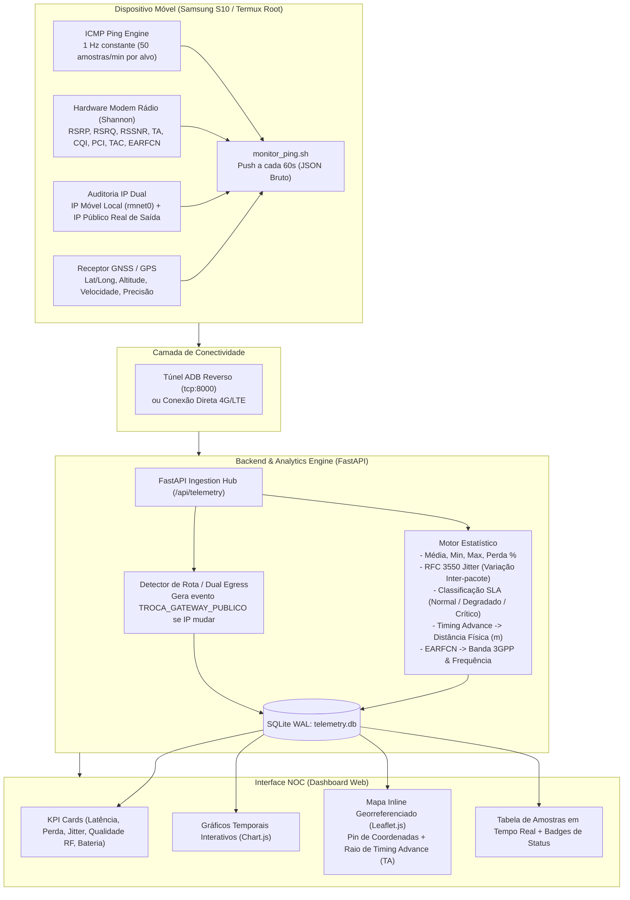

# CellDiag Telemetry - Sistema de Telemetria Celular, RF e Latência

Sistema completo de telemetria de telecomunicações, diagnóstico de radiofrequência (4G/LTE), auditoria de rota pública (Dual IP Egress), monitoramento contínuo de latência (ICMP 1 Hz com cálculo de RFC 3550 Jitter e SLA), geolocalização GNSS em tempo real e painel NOC em FastAPI com mapa interativo inline.

Desenvolvido para dispositivos móveis com acesso root (Samsung Galaxy S10 / Termux) integrado a um backend Python de alta performance.

---

## 1. Visão Geral da Arquitetura

O sistema opera no modelo **Borda Coletora (Celular) -> Ingestão & Analytics (FastAPI) -> Observabilidade NOC (Dashboard Web)**:



---

## 2. Estrutura de Diretórios do Projeto

```text
celldiag-telemetry/
├── README.md               # Documentação principal da arquitetura e operação
├── .gitignore              # Filtro de banco SQLite, caches e arquivos temporários
├── docs/
│   └── RUNBOOK.md          # Guia operacional detalhado, comandos ADB, Tabby e SSH
├── scripts/
│   ├── monitor_ping.sh     # Agente de borda: pings 1Hz, RF, GNSS, IPs e push JSON
│   ├── rfdiag              # Utilitário CLI completo de engenharia de RF e vizinhas
│   ├── siminfo             # Diagnóstico de SIM Card (ICCID, IMSI, APN, rede)
│   ├── test_gps.sh         # Script utilitário de validação de visada GNSS
│   └── test_tech.sh        # Script utilitário de validação de agregação de portadora
└── server/
    ├── main.py             # Backend FastAPI, motor estatístico e rotas de telemetria
    ├── start_server.bat    # Inicializador rápido para ambiente Windows
    └── static/
        ├── index.html      # Dashboard NOC dark theme com layout responsivo
        ├── styles.css      # Estilização completa (Glassmorphism, Cards, Mapa)
        └── app.js          # Polling assíncrono, renderização Chart.js e Leaflet
```

---

## 3. Especificações Técnicas e Métricas

### 3.1. Análise de Latência e SLA
* **Amostragem**: 50 pings por minuto por destino (`8.8.8.8` e IP privado/Gateway).
* **Métricas Processadas**:
  * Latência Média, Mínima e Máxima.
  * **Jitter RFC 3550**: Cálculo padronizado de dispersão de tempo inter-pacote:
    $$D(i, j) = (R_j - R_i) - (S_j - S_i)$$
    $$J(i) = J(i-1) + \frac{|D(i-1, i)| - J(i-1)}{16}$$
  * Taxa de Perda de Pacotes (% packet loss).
  * **Classificação SLA**:
    * `NORMAL`: Latência $\le 80\text{ ms}$ e perda $< 2\%$.
    * `DEGRADADO`: Latência entre $80\text{ ms}$ e $150\text{ ms}$ ou perda entre $2\%$ e $10\%$.
    * `CRITICO`: Latência $> 150\text{ ms}$ ou perda $> 10\%$.

### 3.2. Engenharia de Rádio (4G/LTE)
* **RSRP (Reference Signal Received Power)**: Nível de potência em dBm com indicação de qualidade (Excelente $\ge -80$, Bom, Regular, Ruim $\le -105$).
* **RSRQ (Reference Signal Received Quality)**: Qualidade do sinal recebido em dB.
* **RSSNR (Signal-to-Noise Ratio)**: Relação sinal/ruído em dB.
* **Timing Advance (TA)**: Distância estimada até a estação rádio base (eNodeB):
  $$\text{Distância (m)} = TA \times 78{,}12\text{ m}$$
* **Tecnologia & Agregação**: Identificação de `LTE` ou `LTE+ 4.5G (Carrier Aggregation)`.
* **EARFCN & Bandas**: Tradução do canal de rádio para bandas 3GPP (ex: B28 700MHz, B7 2600MHz, B3 1800MHz).
* **Topologia Celular**: PCI (Physical Cell ID), TAC (Tracking Area Code) e eNodeB ID.

### 3.3. Auditoria de Rotas e IP Público (Dual Egress)
* Monitoramento do IP local da interface celular (`rmnet0`).
* Resolução periódica do IP público externo via interface celular.
* **Detecção Automática de Troca de Gateway**: Se o chip alternar a saída pública entre dois IPs de rota, o sistema dispara o evento `TROCA_GATEWAY_PUBLICO` na tabela `route_events` e destaca o status no painel.

### 3.4. Georreferenciamento em Tempo Real
* Coleta de latitude, longitude, altitude, velocidade e acurácia via satélite (GNSS).
* Renderização direta na tela inicial através do mapa interativo Leaflet:
  * Marcador de localização atual do veículo / dispositivo.
  * Círculo representativo do raio do **Timing Advance (TA)** centrado no dispositivo.

---

## 4. Guia Rápido de Instalação e Execução

### 4.1. Configuração do Dispositivo Móvel (Android Root)
1. Instale o Termux e Termux:API no aparelho.
2. Copie o script de monitoramento para o celular:
   ```bash
   cp scripts/monitor_ping.sh /data/data/com.termux/files/home/bin/
   chmod +x /data/data/com.termux/files/home/bin/monitor_ping.sh
   ```
3. Garanta que o encaminhamento reverso do ADB esteja ativo (para execução local):
   ```powershell
   adb reverse tcp:8000 tcp:8000
   ```
4. Execute o agente de monitoramento:
   ```bash
   monitor_ping.sh
   ```
   *(Ou em background: `nohup monitor_ping.sh > /dev/null 2>&1 &`)*.

### 4.2. Execução do Servidor FastAPI & Dashboard
1. Instale as dependências Python:
   ```bash
   pip install fastapi uvicorn
   ```
2. Inicie o servidor:
   ```bash
   cd server
   python -m uvicorn main:app --host 0.0.0.0 --port 8000
   ```
3. Acesse a interface web no navegador:
   **`http://localhost:8000`**

---

## 5. API REST - Endpoints Principais

| Método | Endpoint | Descrição |
| :--- | :--- | :--- |
| `POST` | `/api/telemetry` | Ingestão de dados brutos enviados pelo dispositivo móvel |
| `GET` | `/api/telemetry/latest` | Retorna a última amostra processada com métricas e localização |
| `GET` | `/api/telemetry/history?limit=100` | Histórico de amostragens para alimentação dos gráficos |
| `GET` | `/api/route-events` | Registro de eventos de troca de IP público e rotas |
| `GET` | `/api/health` | Status de integridade da API e contagem total de registros |

---

## 6. Documentação Operacional
Para instruções de conexão SSH com Tabby, diagnósticos pontuais com `rfdiag`, leitura de SIM card com `siminfo` e procedimentos de troubleshooting, consulte o documento:
* [Runbook Operacional](docs/RUNBOOK.md)
